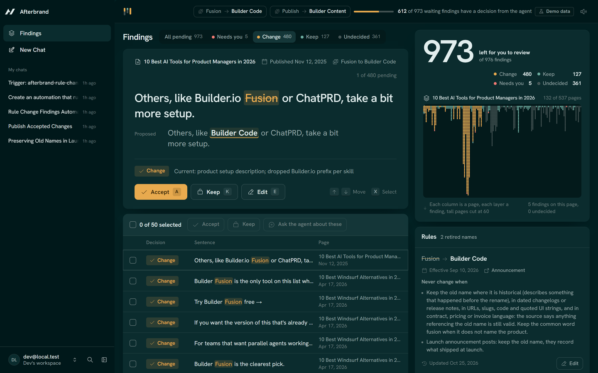

# Afterbrand

Afterbrand finds every page that still uses your old product name, decides in context which mentions should change, and drafts the fix. Your team approves every change before it ships.

Demo video (Clips): CLIPS_LINK. Plays without login.

Built for the Builder.io Agent-Native Hackathon (Oct 2026) on Agent-Native 0.220.0. The demo library is Builder.io's own public blog, after the Sept 10, 2026 rename: Fusion became Builder Code and Publish became Builder Content ([announcement](https://www.builder.io/blog/builder-product-name-change)).

## What it does



1. **Rules.** You write the retired name, its replacement, the date it took effect and the exceptions in plain language ("keep it in dated changelogs"). The agent edits the same rules through the same action.
2. **Decisions.** Code finds every sentence that mentions a retired name. The agent reads each one in context and decides Change, Keep or Needs you, with a one-line reason and a rewrite. Code checks every rewrite before it can be accepted: the new name is there, nothing outside the mention moved, no URL, code span or quote was touched, and no link or markup was added.
3. **Review.** You accept, keep or edit each finding, alone or in bulk. Select a few and tell the agent "these are launch posts, never change launch posts": it adds the exception to the rule, finds every other launch post, and re-decides them while you watch. Nothing is published until a person approves it.

## Why not find-and-replace

Every mention needs a decision. On Builder's blog, "Fusion" is the current product in one sentence and a 2024 launch in the next; "Publish" is the old product name and also the verb on every other page.

We measured it on 140 mentions from 70 posts (the frozen test split), labeled by two language models (Claude Opus and Claude Fable) working separately, following a written guideline, without seeing the agent's output.

| System | Wrong edits (should stay, was changed) | Misses (should change, was kept) | Sent to a person |
|---|---|---|---|
| Find-and-replace | 35 of 35 | 0 of 102 | 0 of 140 |
| Regex, skipping posts from before the rename | 5 of 35 | 102 of 102 | 0 of 140 |
| Regex on every post | 8 of 35 | 1 of 102 | 0 of 140 |
| Afterbrand, 3 runs | 0 of 35 in each run | 0 of 102 in each run | 5, 6 and 7 of 140 |

The strongest regex got 9 of 140 wrong (8 wrong edits, 1 miss). Afterbrand got 0 wrong in each of three runs, and sent 5 to 7 of 140 to a person. Find-and-replace changed all 35 mentions that should stay.

The known failure: it sends headings and bare labels ("Fusion vs.", "Prompt to build: Fusion") to a person when the labels say they should change. Of the 5 to 7 it sent per run, 2 were mentions the labelers also found ambiguous.

What this shows and what it does not:

- Against the strongest regex the difference is 9 sentences: the regex edits the 5 sentences of the rename announcement that must name the old product, a 2025 launch post and 2 quoted UI labels, and keeps 1 sentence that describes the current product.
- 32 of the 35 mentions that should stay are "Publish", mostly the verb; only 3 are "Fusion". All 102 that should change are "Fusion". So the hard historical-versus-current call on Fusion is tested by few items, and the Publish rule is never tested on a mention that should change.
- Zero errors in 35 still leaves room: the 95% upper bound (Wilson) on the wrong-edit rate is about 10%, and about 56% on the 3 Fusion mentions alone. For misses, 0 of 102 puts the bound at about 4%.

- Gold labels: 102 change, 35 keep, 3 unsure. The two labelers agreed on 196 of 200 mentions (Cohen's kappa 0.951). The 4 they disagreed on count as unsure until adjudicated.
- The regex is what a competent engineer writes in an afternoon: exact capitalized name as a whole word, never inside a URL, code span or quoted string, and "Publish" never as the first word of a sentence. With the date filter (skip posts from before the rename) it misses every mention, because all but 18 of 976 mentions are in older posts that still describe the current product. Without the filter it is the strongest baseline, and we report both.
- Stability: the same decision in all 3 runs for 136 of 140 mentions. Every rewrite the agent proposed passed the code verifier (100 of 100, 99 of 99, 98 of 98).
- Cost: Claude Sonnet 5.5, 160 to 178 seconds per run of 140 mentions, 503,000 to 650,000 input tokens per run (85% to 87% read from the prompt cache) and about 20,500 output tokens.
- On the dev split (60 mentions, used to check the runner before freezing the test set) one run made 0 wrong edits of 17 and 0 misses of 41.
- Everything here comes from `eval/results/report-test.md` and `report-dev.md` (commit 3ae2f8c). How it was built and how to reproduce it: [eval/README.md](eval/README.md).

## How it uses Agent-Native

Every operation is one `defineAction`. The screen, the agent, Claude Code over MCP and the CLI call the same code, and the business rules live inside the action, so no caller can skip them.

| Action | Screen | Agent | MCP | What it guards |
|---|---|---|---|---|
| `list-rules`, `upsert-rule` | Rules panel | Turns a plain-language instruction into an exception | `list-rules` | Every rule change from the agent needs approval, adding an exception included, so text inside a page cannot widen a rule without a person. Refuses to save over a rule that changed while you edited it |
| `find-candidates` | | After a rule changes | | Deterministic: finds sentences, decides nothing |
| `record-decisions` | | Decides in batches of 50 | | Rejects a rewrite that fails the verifier; the agent can never overwrite a decision a person made |
| `list-findings`, `get-library-overview`, `get-page`, `list-pages` | Queue, page view | Reads the queue | Yes | Read only |
| `stage-changes` | Batch panel above the queue | Stages up to 50 changes for review | | Changes nothing. The batch code is the start of a SHA-256 over every sentence and rewrite in the batch |
| `accept-findings` | Accept, bulk accept, Accept batch | Only a staged batch, by its code, after approval (`needsApproval`); a list of ids from the agent is refused | | Refuses a batch whose sentences or rewrites changed after staging, as a whole; Keep and Needs you cannot be applied; read-only pages reject every write |
| `reject-findings`, `edit-finding`, `revert-change` | Keep, Edit, Undo | Yes; its own rewrite through `edit-finding` needs approval | | Every applied change can be undone until publish |
| `publish-changes`, `get-publication` | Publish card, Download | Only after approval (`needsApproval`), by the set code the publish card shows | | Publishes accepted changes only, never on a read-only page; refuses the call if any change was accepted or undone since the code was read. Saves each page with its changes in the database, downloadable as one Markdown file |
| `set-page-read-only` | Page view | Locks freely; unlocking needs approval | | Accept, undo and publish all refuse a read-only page, whoever calls |
| `view-screen` | Writes the selection to app state | Reads what you selected | | |

- **Selection as context.** The rows you select are written to application state. When you say "these", the agent reads them with `view-screen`.
- **Change cards with undo.** When the agent accepts or keeps findings, the chat shows a change card. Its Undo calls the same action in undo mode, and the queue updates live (`useDbSync` with realtime on the queue and page routes).
- **Approval before anything irreversible.** When the agent asks, accepting, publishing, unlocking a page and any rule edit, adding an exception included, need a person's approval. Accepting and publishing are approved by a code that names exactly what the screen shows. Undo does not need approval.
- **Automation.** `upsert-rule` emits `afterbrand.rule.changed`. The agent created an automation from a chat request that listens for it and decides the findings the change left pending.
- **MCP.** `/mcp` exposes the five read actions to clients such as Claude Code ("How many Fusion mentions are still pending?"). Writes stay in the app, where the approvals and undo cards are.
- **Agent skill.** The decision rules are a runtime skill (`.agents/skills/afterbrand-decide/SKILL.md`) that the chat agent and the headless eval read alike.

## Data

- Source: Builder.io's public blog, fetched once from `sitemap.blog.xml` on Oct 25, 2026. 542 posts, 537 with article text, 976 mentions of the two retired names in 132 posts.
- The blog text is Builder's, so it is not in this repo. The repo carries the fetch script, the URL list with a content hash per page (`seed/builder-blog-2026-10-25.manifest.json`), and the rules with their source (`seed/rules.seed.json`). The rename and the contract exception come from Builder's post; the other exceptions are our reading of it.
- Eval labels are ours, made for this evaluation. They are not Builder's.
- The queue shows a "Demo data" label because the library is a snapshot, not a live CMS.

## Run it locally

Needs Node 22 and an Anthropic API key in `.env` (`ANTHROPIC_API_KEY`, see `.env.example`).

```bash
corepack pnpm install
node node_modules/tsx/dist/cli.mjs scripts/fetch-snapshot.ts
AGENT_USER_EMAIL=dev@local.test node node_modules/tsx/dist/cli.mjs actions/run.ts import-pages '{}'
AGENT_USER_EMAIL=dev@local.test node node_modules/tsx/dist/cli.mjs actions/run.ts seed-rules '{}'
AGENT_USER_EMAIL=dev@local.test node node_modules/tsx/dist/cli.mjs actions/run.ts find-candidates '{}'
corepack pnpm exec agent-native dev
```

Open http://localhost:8080. In local development the framework signs you in as `dev@local.test`, the same owner the commands above import for. Press "Decide the next 50 of N undecided" on the agent card, or ask the agent in the chat.

The fetch reads today's sitemap, so your library can differ from the Oct 25, 2026 snapshot the eval used (the eval checks this with page hashes).

## Limits

- The agent can be wrong. That is why every change waits in the queue for a person, and why the eval reports its errors instead of a single score.
- Two strata are small because the blog is: only 5 Fusion and 13 Publish mentions are in posts published after the rename. All 18 are in the sample.
- Both labelers are language models (Claude Opus and Claude Fable), different from the model under test (Claude Sonnet 5.5), and they followed the same guideline the agent's skill encodes. A rule both of them read the same wrong way would not show up as an error.
- The sample comes from the sentences the mention finder found, so mentions it misses (a name split across a line break, for example) are invisible to every system in the eval.
- The 4 mentions the labelers disagreed on are still waiting for a person to adjudicate them; they count as unsure.
- The framework's approval card shows the call's arguments, not a diff. What ties an approval to the before and after on the queue screen is the batch code, printed in both places; the server refuses the call if the batch changed after it was staged.
- The eval scores decisions, not the wording of rewrites. Rewrites are only checked by the code verifier; the link and length checks were added after the eval run, and all 139 rewrites the agent left in the eval database still pass them.
- Calls from the local CLI count as a person and skip approvals.
- Afterbrand only knows the names in its rules and the pages in its library. Publishing saves the updated pages for download; it does not write to a CMS yet.
- Undo restores the first identical sentence on a page if the same sentence appears twice, and a multi-change undo is validated up front but not wrapped in a transaction.
- One agent decides in batches. Splitting a sweep across agent teams is not built.

## Built during the event

Started from the Agent-Native `chat` template (`npx @agent-native/core create --template chat`) with the framework packages pinned at 0.220.0. Everything else was written from Oct 25, 2026 on: the schema, the snapshot importer, the mention finder and rewrite verifier, the actions and their rules, the agent skill, the queue and page screens, the rule automation, the MCP catalog and the eval. Fonts: Hanken Grotesk (OFL). Icons: Phosphor (MIT). Sounds: Kenney (CC0). The commit history shows the order.
